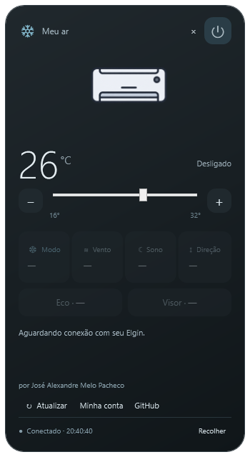
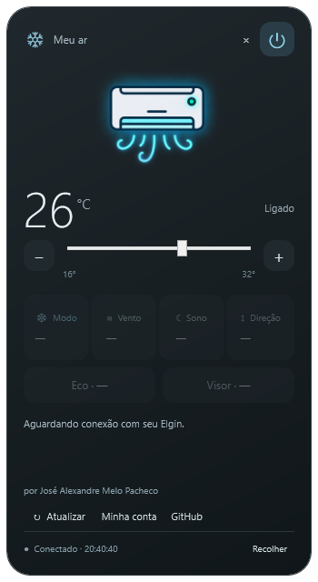

# AirTray

[English](README.en.md) · Português

**Controle real de aparelhos compatíveis com Elgin Air na bandeja do Windows.**

Criado por **[José Alexandre Melo Pacheco](https://github.com/JoseAlexandreMeloPacheco)** · [Código e sugestões](https://github.com/JoseAlexandreMeloPacheco/airtray/issues)

> Cliente independente e experimental. Não é uma demonstração: envia comandos reais usando a conta do usuário. Não possui afiliação ou autorização de distribuição confirmada pelo fabricante. Veja [compatibilidade e terceiros](THIRD_PARTY.md) antes de usar.

 

As imagens acima foram geradas com dados de teste; não mostram uma conta ou aparelho de terceiros.

## Antes de usar: conecte o ar ao Wi-Fi e à sua conta

**O ar-condicionado precisa estar conectado a uma rede Wi-Fi com internet e vinculado à mesma conta Elgin Air que você usará no AirTray.**

1. Configure o Wi-Fi e adicione o aparelho à sua conta pelo aplicativo **Elgin Air** no celular.
2. Confirme que o aparelho aparece online e que você consegue controlá-lo pelo aplicativo do celular.
3. Depois, entre no AirTray com **a mesma conta e a região correta**. O computador também precisa ter acesso à internet.

O AirTray usa os aparelhos já cadastrados nessa conta. Ele não faz o pareamento inicial nem configura o Wi-Fi do ar.

📺 [Vídeo indicado para ajudar na configuração do ar no Wi-Fi e no aplicativo](https://www.youtube.com/watch?v=a8oWKxC60GU)

Se o aparelho não aparecer, confira primeiro se ele está online no Elgin Air e se você entrou na conta e região corretas. A configuração inicial não altera a lista de modelos compatíveis com este projeto.

## Baixar e usar

1. Em [Releases](https://github.com/JoseAlexandreMeloPacheco/airtray/releases), baixe o pacote experimental `AirTray-0.3.0-windows-x64.zip` quando disponível.
2. Instale o **.NET Desktop Runtime 10 x64**, extraia o ZIP inteiro e abra `AirTray.exe` no Windows x64. O executável não é assinado digitalmente.
3. Entre com **sua própria conta Elgin Air** e escolha a região do cadastro. A região não é necessariamente o país onde você mora; algumas contas brasileiras usam Mainland/China.
4. Havendo vários aparelhos compatíveis, escolha o que deseja controlar. Para trocar depois, abra o menu de contexto de **Minha conta**.

Este projeto não inclui contas, senhas ou aparelhos de exemplo para controle real. A senha fica no Gerenciador de Credenciais do Windows, alvo `ElginTray/ElginAir`, sob seu usuário. O menu de contexto de **Minha conta** permite desconectar a sessão ou esquecer a conta salva. Entrar pode desconectar o aplicativo do celular, conforme o modo de login do serviço.

## Compatibilidade testada

- Família de produto AUX/Elgin com identificador terminado em **c0620000**, usada pelo Elgin Air 1.0.1.
- Login, descoberta, leitura, mudança de temperatura e restauração foram validados em um aparelho e uma conta autorizados. Outros usuários e variantes ainda precisam de testes.
- Não há promessa de compatibilidade com todos os modelos Elgin, Elgin Smart, outros aplicativos ou outras marcas. A ausência de aparelho compatível é informada, sem escolher outro dispositivo arbitrariamente.
- Requer internet e serviços de nuvem do fabricante disponíveis. Mudanças no serviço podem interromper a integração.

## Controles

Ligar/desligar, temperatura entre 16 e 32°C, modo, ventilação, sono, oscilação vertical, economia e visor, conforme as propriedades recebidas. Cada ajuste é seguido de uma consulta para mostrar o estado confirmado. A interface atualiza a cada 30 segundos e tem atualização manual.

Clique no ícone da bandeja para abrir/recolher. **×**, **Recolher** e **Alt+F4** ocultam o painel. **Encerrar aplicativo…**, no menu da bandeja, exige confirmação e não desliga o ar. O botão **GitHub** abre este projeto no navegador; seu nome de autor fica visível no painel.

## Compilar e verificar

Com .NET SDK 10 instalado, na raiz do repositório:

```powershell
powershell -ExecutionPolicy Bypass -File scripts/Build.ps1 -Verify
.\artifacts\airtray\AirTray.exe
```

Após compilar, também é possível usar `Abrir AirTray.cmd`. Os testes automatizados são offline: verificam leitura/validação do protocolo, imagens, recolhimento e reabertura sem acessar credenciais nem enviar comandos. Eles não substituem os testes com hardware. Detalhes em [docs/audit.md](docs/audit.md).

Para gerar o ZIP de distribuição:

```powershell
powershell -ExecutionPolicy Bypass -File scripts/Package-AirTray.ps1
```

O pacote é dependente do runtime, contém documentação e licença, e fica em `artifacts/release`. Nenhuma credencial local é copiada. Nunca distribua um ZIP da pasta inteira de desenvolvimento. `scripts/Prepare-GitHub.ps1` verifica a lista de arquivos preparados no Git, mas não faz commit nem upload.

## Estrutura e segurança

`AirTray/` contém a interface WPF/bandeja, armazenamento no Windows e cliente HTTPS reconstruído de forma independente a partir do comportamento do aplicativo. Não são distribuídos APK, SDK binário, código decompilado ou relatórios privados. Os algoritmos legados de autenticação reproduzem o protocolo existente; não são recomendação para novos sistemas de login.

As constantes de compatibilidade da aplicação estão no cliente e são distintas da senha do usuário. Sua presença no aplicativo original não comprova autorização para reutilização pública. Consulte [THIRD_PARTY.md](THIRD_PARTY.md) e [SECURITY.md](SECURITY.md). Não envie senha, sessão ou respostas brutas da nuvem em issues.

## Licença

Código desenvolvido para este projeto sob [MIT](LICENSE). Essa licença não concede direitos sobre software, marcas, licenças de aplicação ou serviços de terceiros. A arte foi fornecida como imagem gerada por IA; [proveniência](AirTray/Assets/README.md).
